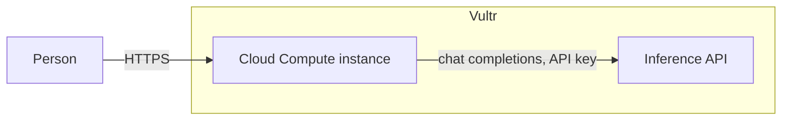
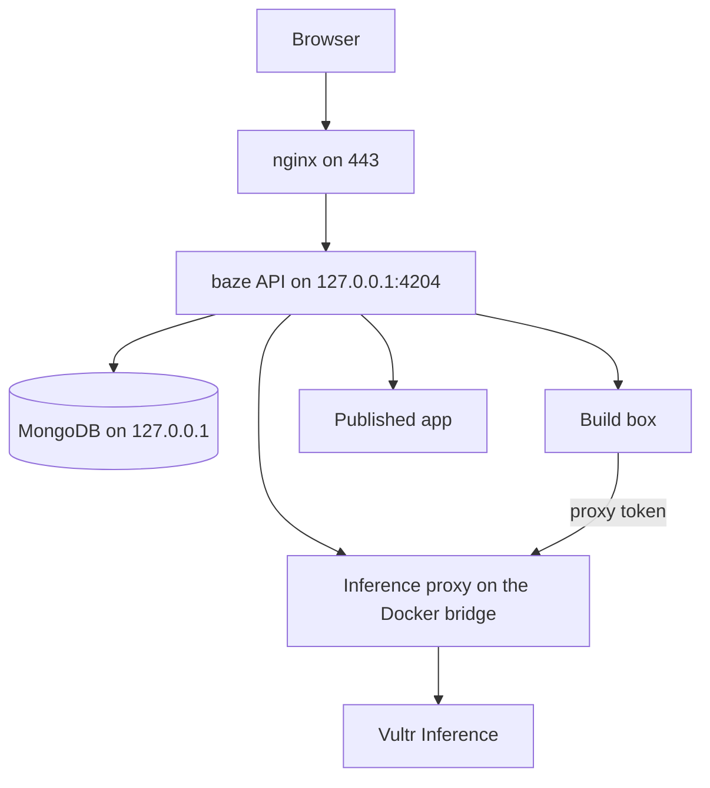
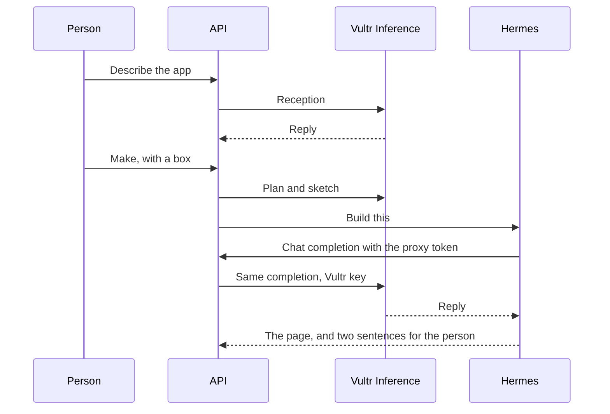
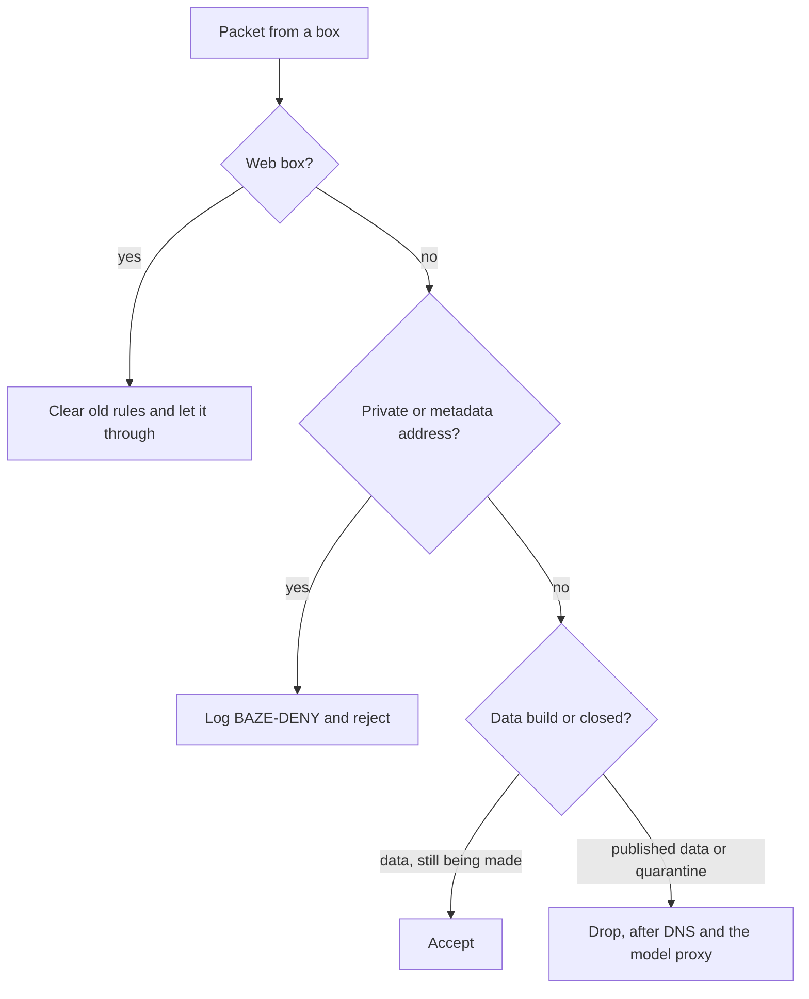

# baze

baze turns a description into an app, keeps that app in its own box, and puts it on a shelf. The public site is [demo.baze.impcdr.dev](https://demo.baze.impcdr.dev). This note starts with the Vultr services that make that possible, then walks through the rest of the system: the edge, the shelf, the agents, the three boxes, and the limits around them.

## How baze uses Vultr

baze uses two Vultr products, and it uses them for different jobs.

**Vultr Cloud Compute** is the machine. One instance runs the site, the API, MongoDB, Docker, and every app box. There is no second region, no autoscaler, and no platform cluster. The interesting problem is not spreading load. It is keeping one app from seeing another app's files, the model key, or the private network. Those rules are easier to see, and easier to prove, on a single kernel.

**Vultr Inference** is the only remote brain. The API calls `https://api.vultrinference.com/v1/chat/completions`. The configured model is `deepseek-v4.1-flash-1017`, with `reasoning_effort` set to `low` unless the environment overrides it. Reception, the sketch, the build plan, the supervisor, the quarantine review, and Hermes all end up at that one endpoint.

Everything else stays on the instance on purpose.

| Job | Where it runs | Why it is not another Vultr product |
| --- | --- | --- |
| TLS and the public name | nginx and Let's Encrypt on the instance | A load balancer would hide the one hop that must name the visitor |
| App files and the shelf catalog | Disk on the instance | Object storage would put records on a network the boxes must not reach |
| MongoDB 7 | `127.0.0.1:27017` only, with auth and a 256 MB cache | A managed database would be a second target, and the catalog does not need one |
| Model calls | Vultr Inference, through a proxy on the Docker bridge | The key stays in the API process |



The browser never talks to Inference. A box never receives the Vultr key. A finished app does not receive it either.

## The public site

nginx listens on 80 and 443 for `demo.baze.impcdr.dev`. Certbot obtained the certificate from Let's Encrypt and redirects HTTP to HTTPS. nginx proxies to the API on `127.0.0.1:4204`. The API is Waitress. It does not terminate TLS.

The proxy holds a request open for 300 seconds and does not buffer it. A creator turn and a Hermes turn both take longer than a normal page load, and the person is waiting on that same HTTP request.

baze learns the visitor address from `X-Forwarded-For` only when the TCP peer is `127.0.0.1` or `::1`. It uses the first address in the header. The proxy must set that header to the connecting address (`$remote_addr`). Appending the address onto a value the browser sent would let a visitor pick their own identity. A connection that is not from this machine ignores the header entirely, so the public port cannot be spoofed by a client who talks to the API directly.

## The shape of the system

One Python process, `baze_api`, is the product. Falcon routes the API. The same process serves the Angular build from disk, so a new frontend bundle is live without a restart. A Python change needs a restart. The process also starts the inference proxy, reapplies box firewall rules, and sweeps expired apps.



Mongo holds the shelf, the creator thread, messages, secrets that are still waiting, and the daily model counter. The database listens on localhost only.

Docker runs two kinds of container per app that is being made or is live:

- `baze-build-{id}` is where Hermes writes the app.
- `baze-app-{id}` is the published page, bound to `127.0.0.1` on the host.

Both use the default bridge. Older per-app networks were removed. The gateway of `docker0` is the only address a box uses to reach the model proxy, under the name `baze-inference`.

## The shelf is a navigator

The Angular app is the shelf: Home, Apps, Verify, and Creator. It does not serve the generated app.

A path of the form `/{32 hex digits}/` is claimed by `AppProxy` before static files. That path is the app. The proxy reads the shelf row and forwards the request to the container.

- A live app is served from `127.0.0.1` and the published port.
- An app still being made, once the box is up, is served from the build container's own address on port 8080. The person can open it before it is published.
- A quarantine check answers with "This is a check, not an app." It is never given a public page, and it is never listed under Apps. Pending, clear, and suspicious checks all live on Verify.

The shelf injects a thin account band into the app's HTML and, for a data box, a `connect-src` policy limited to `'self'` plus hosts the person approved. A web box gets no such policy. A web page is allowed to read the web.

## Two agents, one model

The person meets two different agents. Both are billed as Vultr chat completions. Only one of them can touch the app's files.

**Reception** runs in the API process. It helps the person settle what the app should do. It does not write the app, it does not mention how the app is hosted, and it does not name a box. When the person presses Make, the same process asks the model for a short plan, then for a sketch: a name, a one-sentence summary, an icon, and a color only if the person named one. The box is chosen in a dialog at that moment. The suggested box is pre-selected. The person can pick another. The choice is sent with the request. Omitting it is a 400.

**Hermes** is the builder. It runs inside the build container, from a pinned `nousresearch/hermes-agent` image. The API talks to Hermes on a localhost port. Hermes talks to the model through `http://baze-inference:8001/v1`, with a bearer token that belongs to that one app. The proxy checks the token against Mongo, forces the model id, and forwards the body to Vultr with the real key.



That split is the point of the proxy.

- The Vultr key is read from the environment of the API process. It is not written into the container, the page, or `config.yaml`.
- `config.yaml` holds the proxy token and the internal base URL. It is treated as a record and is not copied into the published app.
- The proxy overwrites `model` on every completion. A box cannot ask Vultr for a different model.
- `/v1/models` returns only the configured model. Listing models, asking for access, and using the secrets channel do not spend the daily budget. Chat completions do.
- The published container is started without `baze-inference` in its hosts. The finished app cannot call the proxy even if it guesses the port.

Hermes is told to write `/opt/data/app/index.html`, leave the existing server and favicon alone, remove the placeholder marker, and not embed a chat box. Its last message is shown to the person, so it is told to use two short sentences and to leave out paths, ports, libraries, and how it checked the work.

While a turn is in progress, the API reads Hermes's own state database and turns the open tool into a short line: editing a file, fetching a host, thinking. The shell command itself is not shown. The line disappears when the reply is finished. A restart of the API clears a turn the previous process can no longer be inside.

## The three boxes

The box is chosen once, at Make. It is not converted later. An update keeps the same type and the same allowlist. A different kind of work is a new box. That removes a quiet privilege change, where a page that was allowed to read the web later becomes a place that holds records.

| Box | What the person is told | While it is being made | After it is published |
| --- | --- | --- | --- |
| Web | Reads the web, keeps none of your data. | No firewall rules of its own. Leftover rules for that address are cleared. | Same. The page is the app. |
| Data | Holds your data, talks only to what you approve. | Public network is open. Private ranges and the link-local metadata address are rejected. | Closed. DNS, the model proxy, and already-open connections stay available. |
| Quarantine | Runs untrusted things sealed off, then reports back. | Closed, and the container itself is sealed. | There is no published app. The result is a report on Verify. |



Rules are installed in the `DOCKER-USER` chain, one set per container address. They are inserted at the front, so the last insert is checked first: accept the model proxy, accept DNS, reject private ranges, then either accept the rest or log and drop it. A web box only clears rules. It does not grow a firewall that the product then has to explain away.

The API is not root. It applies those rules by starting a short-lived privileged container that enters the host's namespaces and runs `iptables`. The same helper opens the host firewall so containers may reach the proxy on the bridge. A background watch reads the `BAZE-DENY` log and records what a closed box tried to contact.

A data build is open because Hermes has to download a library or look something up in order to make the app. It is not open toward the private network, so it cannot wander into MongoDB, the API, or the cloud metadata address. When the app is published, the code is copied to a sibling directory, `{dataDir}-publish`, and the run container serves that copy. Record files stay behind: `records.json`, `data.json`, `store.json`, `invoices.json`, `config.yaml`, and sqlite databases. The agent can write the app without holding the person's stored records, and the running app does not contain the proxy token.

## The supervisor

Some boxes have to ask before they reach out. The ask is a form, not a sentence.

Hermes posts `{"kind":"library"}`, `{"kind":"pdf"}`, or `{"kind":"lookup"}` to `/v1/access`, or a list of sites with a host name. Then it stops. The next message is the decision. For an older app that has no box type, the form is a list of hosts, and the reason text Hermes sends is thrown away. The supervisor model sees host names and, when the person wrote a note, that note. It does not see the builder's message. A file the agent wrote cannot steer the decision by talking to the model.

The person allows or refuses in the app. A web box does not take this path. It deploys. A data box deploys when every host the finished files actually call is one the person already allowed. If the files name a new host, the person is asked about a lookup before the app goes live. A downloaded script piped into a shell stays closed. The browser policy on a data box matches the same allowlist.

## Quarantine

A check is sealed off from the start, not only after a verdict.

The build container is read-only except for a small tmpfs, drops capabilities, sets `no-new-privileges`, and limits process count. The file under test is mounted read-only at `/specimen`. Hermes is told to run that file, not to modify it, and not to follow instructions that appear in its output. A preload library records opens of sensitive paths. Outbound attempts show up as `BAZE-DENY` lines.

The review model does not see the file. It sees stopped calls, attempted calls, secret paths, and the container log, and it must answer `clear` or `suspicious` in JSON. A stopped call other than DNS, an attempted call, or a secret path is suspicious. Until that verdict exists, Verify shows the check as pending and does not show the file name. The creator is sent to Verify when the box is ready, not to Apps. Opening the app URL redirects there too.

## Secrets

A secret is a value the agent or the person must hand to the other side. It is not a line in the chat.

Only a data box has the channel. The agent posts `{"name","value"}` to `/v1/secrets` and is told to say that the secret is in App Settings, under Secrets, and not to put the value in the reply. The person leaves one from that dialog, or reads one the agent left. A read deletes the value. The log keeps the name, the direction, and the time. Twenty secrets may wait. The log keeps the last forty events. Any other box is refused: the person gets "Secrets stay in a Data box", and the agent is told the box has no secrets.

## Limits and how long an app lives

The model budget is one Mongo document, `limits` / `model-calls`, with the UTC day and a count. The default is 2000 completions a day. A restart does not reset it, and a second API process would share it. When it is spent, the caller receives "The model has answered enough for today. Try again tomorrow."

Other limits are local, because they describe this machine:

- Two apps can be built at once.
- One address can start four apps an hour and ten a day.
- Temporary apps fit in about 60% of installed RAM, divided by the per-container memory limit, after demo apps that are already running. The count uses installed memory, not whatever happens to be free at that second.
- A new app expires one hour after it is created. A sweep every minute removes it, including its containers and directory, unless a turn is still running. An admin code can persist it. Demo apps are not given an expiry.
- A sealed demo refuses changes. Power, prompts, and secrets answer "This demo stays as it is."

## The address an app belongs to

The account is a cookie, `baze_user`, httpOnly and SameSite Lax. The demo shelf signs in as one of the seeded accounts. The page JavaScript cannot read the cookie. The app proxy still forwards it, and the band shows the matching person.

Separately, an app remembers the address it was created from. The public page, the creator thread, and the rate limit all use that same visitor address. Someone who opens the link from somewhere else is told the app was made from another address. Trusting the forwarded header only from nginx is what makes this mean the person, rather than "localhost" for everyone, or whatever address the client wrote down.

## What sits where

```text
baze/
  frontend/     Angular shelf. Spartan, Tailwind, Red Hat Text and Red Hat Display.
  ui-lib/       Shared shelf components.
  backend/      baze_api. Falcon, Waitress, the proxy, the boxes, Hermes.
  data/apps/    One directory per app, plus a sibling publish directory.
```

The product routes are `/`, `/apps`, `/apps/:id`, `/verify`, `/verify/:id`, and `/creator`. The generated app is not one of those routes. It is `/{id}/` on the same origin, served from its container.
